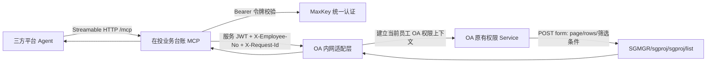
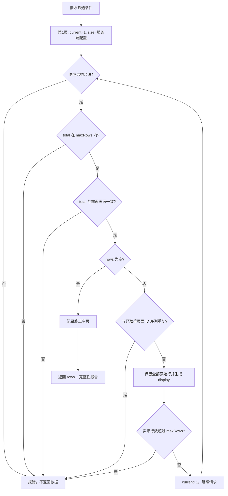
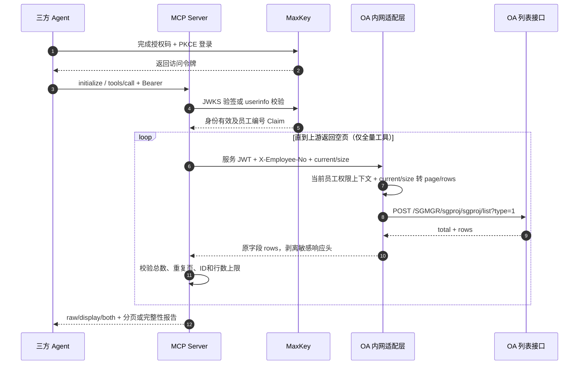

# 在投业务台账 MCP 接入说明

> 版本：V1.0｜整理日期：2026-11-11  
> 页面范围：统一数据管理 → 投后数据统计 → 在投业务台账 → 在投业务台账列表  
> 工程：`C:\Users\84732\oa-mcp-server`  
> 状态：代码、单元测试、MCP 协议测试和测试环境接口核验已完成；生产部署与 OA 内网适配层上线不在本次已完成范围内。

## 1. 交付内容

| 工具 | 用途 | 适用场景 |
|---|---|---|
| `get_investment_ledger_schema` | 返回49个页面展示列、8个筛选项、排序字段和字典 | Agent 先理解数据结构 |
| `search_investment_ledger` | 按当前用户权限筛选并分页查询 | 日常问答、按项目/客户查数 |
| `export_investment_ledger` | 自动顺序翻页直到空页，返回全部可见记录及完整性报告 | 批量同步、全量分析 |

三种数据视图：

- `raw`：OA 原始字段，保留页面未展示的 `projectid`、`cusid` 等字段。
- `display`：按页面 datagrid formatter 生成49列，保留金额单位、百分比、字典中文值及页面原有重复列。
- `both`：每行返回 `{raw, display}`，默认值。

## 2. 调用关系图



身份边界：三方调用方不能传员工编号指定取数身份。MCP 只从已验证令牌提取员工编号；OA 适配层只接受受服务 JWT 保护的内网调用。共享 Cookie、共享管理员会话和静态共享 API Key 均不属于本方案。

## 3. 真实接口报文示例

### 3.1 上游列表请求

2026-11-11 在测试环境页面 iframe 内实测：

```http
POST /oamgr/SGMGR/sgproj/sgproj/list?type=1
Content-Type: application/x-www-form-urlencoded; charset=UTF-8

page=1&rows=1&sort=&order=asc
```

页面支持的查询条件：

| 参数 | 含义 |
|---|---|
| `projectnm` | 项目名称 |
| `projectno` | 项目编号 |
| `cusnm` | 客户名称 |
| `ctrtcode` | 合同编号 |
| `compcusnm` | 所属集团/核心企业/付款人 |
| `site` | 项目所在地 |
| `actsts` | `1=正常`、`2=逾期`、`3=已结清`，不传为全部 |
| `dealdate` | 截至该日期未结清项目，格式 `YYYY-MM-DD` |

### 3.2 上游真实响应

```json
{
  "total": 3571,
  "rows": [
    {
      "actbasid": "20261028224138524000002917",
      "actblc": 10000,
      "actdate": "2026-09-18",
      "actsts": "1",
      "avlblc": 10000,
      "begdate": "2026-10-28",
      "billenddates": "无",
      "biztype": "1",
      "city": "东城区",
      "compnature": "8",
      "crtorg": "山钢绿电",
      "crtuser": "王林",
      "ctrtcode": "3243424",
      "cuanms": "无",
      "cusid": "20260817102145291000310353",
      "cusnm": "上海亚朵商业管理（集团）有限公司",
      "drawers": "无",
      "enddate": "2026-11-07",
      "goodsnms": "无",
      "goodstyps": "",
      "industrialchain": "",
      "interest": 16.67,
      "mrgrate": 0,
      "mrgtype": "无",
      "planrealpayint": 0,
      "projamt": 10000,
      "projectid": "20261028224138524000002917",
      "projectnm": "cs",
      "projectno": "",
      "projtype": "0",
      "province": "北京市",
      "realall": 0,
      "realpaycapital": 0,
      "realpayint": 0,
      "rettyp": "1",
      "sgtype": "12",
      "site": "北京市 东城区",
      "strterm": "10天",
      "takeamt": 0,
      "term": 10,
      "termunit": "3",
      "yield": 0
    }
  ]
}
```

全量扫描57个原始字段的并集也已核对。`raw` 视图按行原样保留字段，不用49个展示列反向裁剪原始数据。

### 3.3 MCP 工具调用请求

三方 Agent 完成 OAuth 后，由 MCP 客户端自动携带 Bearer 令牌和会话 ID。`tools/call` 业务报文如下：

```json
{
  "jsonrpc": "2.0",
  "id": 42,
  "method": "tools/call",
  "params": {
    "name": "search_investment_ledger",
    "arguments": {
      "cusnm": "上海亚朵商业管理（集团）有限公司",
      "actsts": "1",
      "current": 1,
      "size": 15,
      "view": "both"
    }
  }
}
```

全量取数只需把工具名改为 `export_investment_ledger`，参数中去掉 `current`、`size`，例如：

```json
{
  "jsonrpc": "2.0",
  "id": 43,
  "method": "tools/call",
  "params": {
    "name": "export_investment_ledger",
    "arguments": {
      "actsts": "1",
      "view": "raw",
      "maxRows": 10000
    }
  }
}
```

## 4. 全量取数流程图



完整性报告字段：

| 字段 | 含义 |
|---|---|
| `complete` | 已到终止空页且没有缺失业务 ID；不表示 `reportedTotal` 必然等于实际行数 |
| `reportedTotal` | 上游接口报告的 `total` |
| `rowCount` | 实际取得并返回的行数 |
| `totalMatchesRowCount` | 上述两个数是否相等 |
| `uniqueIds` / `duplicateIds` | 按 `actbasid` 优先、`projectid` 兜底统计；重复行不擅自去重 |
| `pagesFetched` | 实际请求页数，包含最后的空页 |
| `dataPagesFetched` | 有数据的页数 |
| `terminalEmptyPage` | 是否以空页确认结束 |
| `warnings` | 总数差异、重复 ID、缺失 ID 等完整说明 |

测试环境实测：每页请求200行时，18个数据页共取得3387行，上游报告 `total=3571`，第19页和第20页均返回0行。该差异必须保留，不能补空行、不能把总数改成3387，也不能虚称取得了3571行可见记录。

## 5. 调用时序图



## 6. 错误与重试口径

| 情况 | MCP | REST | 是否建议重试 |
|---|---|---|---|
| 参数格式、状态值、排序字段非法 | `isError=true` | HTTP 400，`code=INVALID_ARGUMENT` | 修改参数后再调用 |
| 未带令牌、令牌失效或会话身份不一致 | HTTP 401 | HTTP 401 | 重新完成 OAuth |
| 上游 total 在取数中变化 | `isError=true` | HTTP 502，`code=UPSTREAM_ERROR` | 整批重新取数 |
| 重复页、超过 `maxRows`、达到翻页安全上限 | `isError=true` | HTTP 502，`code=UPSTREAM_ERROR` | 先排查接口，不消费部分结果 |
| 适配层不可达或超时 | `isError=true` | HTTP 502，`code=UPSTREAM_ERROR` | 有界退避重试 |

## 7. 三方平台接入

- 远程 MCP 传输：Streamable HTTP。
- 远程路径：部署环境实际 `MCP_PUBLIC_URL` 加 `/mcp`。
- 认证：使用本服务配置的 MaxKey OAuth；客户端 ID、授权地址、令牌地址由实际 MaxKey 应用注册结果提供。
- 不支持 MCP 的旧平台：可调用同鉴权的 `/api/v1/tools/search_investment_ledger`、`/api/v1/tools/export_investment_ledger`、`/api/v1/tools/investment_ledger/schema`。
- 日常 Agent 问答优先分页查询，避免一次把数千行送入模型上下文；全量工具用于批量同步或离线分析。
- 当前没有可对外提供的生产 URL 和三方客户端 ID；这两项必须由实际部署与 MaxKey 注册产生，不能使用虚构地址接入。

## 8. 已完成验证

| 验证 | 实际结果 | 证据边界 |
|---|---|---|
| TypeScript 构建 | `npm run build` 通过 | 本机工程实测 |
| 台账单元测试 | 8/8 通过 | 覆盖49列、格式、筛选、全量、重复页、total变化、超限、异常响应 |
| MCP 端到端测试 | 18/18 通过 | mock MaxKey + mock OA 适配层 + 真实 MCP Streamable HTTP 调用 |
| 独立审查 | 8项PASS、0项FAIL、0项UNVERIFIABLE | 审查快照通过；后续补强由主会话按最终文件重新完整测试 |
| 双账号权限 | A/B 行级数据隔离通过 | mock 权限数据验证 MCP 身份传递，不替代生产双账号验收 |
| 页面展示口径 | 94行 × 49列 = 4606项，0差异 | 测试环境真实页面 formatter 与 MCP display 对照 |
| 全量接口核验 | 18个数据页3387行，第19页空页 | 测试环境真实接口只读核验 |

## 9. 上线前置条件

1. OA 开发按 `docs/OA适配层接口规范.md` 开放 `investment-ledger/list`，在 OA 原有用户权限上下文调用列表接口，并保留全部原始字段。
2. MaxKey 管理员完成三方 Agent 客户端注册，确认员工编号 Claim 与 OA 用户映射。
3. 运维配置内网适配层地址、服务 JWT、审计盐、限流和实际 `MCP_PUBLIC_URL`，全部经环境变量或密钥托管注入。
4. 用两个权限不同的测试账号对照 OA 页面做行级验收，再开放给三方平台。
5. 生产全量验收需重新记录 `reportedTotal`、`rowCount`、终止空页、重复 ID 和警告；不得沿用本测试环境数字作为生产结果。
